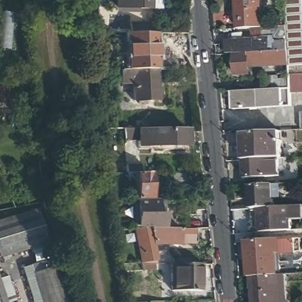
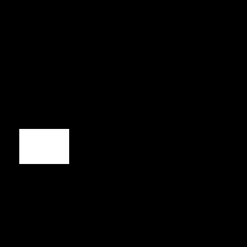
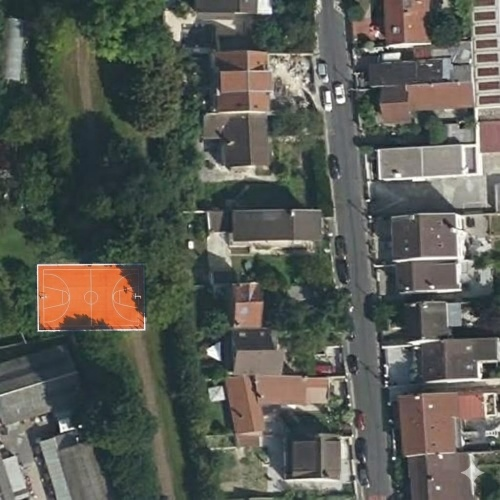
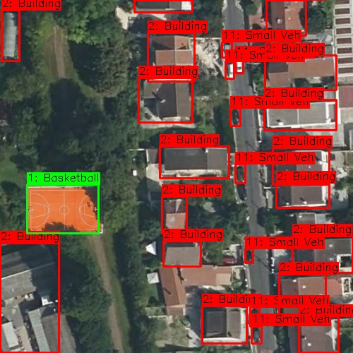

# CADOT Project: Object Detection on Aerial Imagery of Paris

> **IEEE ICIP 2025 Grand Challenge (Cityscape Aerial image Dataset for Object Detection): targeted data augmentation and generative inpainting strategies to improve YOLOv11 detection of rare urban classes**

[](https://cadot.onrender.com/)
[](https://www.python.org/)
[](https://docs.ultralytics.com/)
[](https://albumentations.ai/)
[](academic_project_presentation.pdf)

---

## Project Overview

This project was developed as part of the [CADOT Challenge (IEEE ICIP 2025)](https://cadot.onrender.com/), which tasks participants with detecting 14 categories of urban objects in high-resolution aerial images of the Paris region captured by the French National Institute of Geographic and Forest Information (IGN).

The core challenge is **extreme class imbalance**: common classes such as *small vehicle* (46.7%) and *building* (40.9%) dominate the dataset, while rare classes such as *basketball field*, *football field*, *train*, and *swimming pool* each represent less than 1% of annotations. Standard training produces models that perform well on common objects but miss rare ones.

**Our approach** combines three complementary strategies:
1. **Targeted Albumentations**: class-aware offline data augmentation with pipelines adapted to the visual characteristics of each object type.
2. **Generative AI Inpainting**: synthetic data generation for the rarest class (basketball fields) using Google Gemini's image generator (Imagen 3 / Nano Banana).
3. **YOLOv11 Fine-Tuning**: systematic comparison of model sizes and augmentation strategies.

* **Project Presentation**: For a full visual overview of our methodology, experiments, and final results, see [academic_project_presentation.pdf](academic_project_presentation.pdf).

### Key Results

| Experiment | Model | Epochs | mAP50 | mAP50-95 | Precision | Recall |
|---|---|---:|---:|---:|---:|---:|
| Baseline (no augmentation) | YOLOv11m | 81 | 0.529 | 0.364 | 0.524 | 0.526 |
| Classic Albumentations | YOLOv11m | 61 | 0.540 | 0.359 | 0.584 | 0.525 |
| **Multi-Pipeline Albumentations** | **YOLOv11m** | **85** | **0.558** | **0.373** | **0.560** | **0.568** |
| Baseline + GenAI Basketball | YOLOv11m | 70 | 0.530 | 0.363 | 0.522 | 0.562 |
| Baseline (smaller model) | YOLOv11n | 206 | 0.526 | 0.345 | 0.535 | 0.511 |

**Best model: Multi-Pipeline Albumentations (mAP50 = 0.558, +5.5% over baseline)**

For reference, the official challenge baselines on the validation set are: YOLOv11 mAP50 = 62, YOLOv12 = 56, Faster R-CNN = 33.88, and DiffusionDet = 52.76 (see [baseline comparison](docs/cadot_challenge_baseline_performance.png)).

---

## Dataset

* **Source**: [CADOT Challenge Page](https://cadot.onrender.com/dataset)
* **Download**: [CADOT_Dataset.zip](https://www-l2ti.univ-paris13.fr/iriser/dashboard/pages/download_CADOT_Dataset.php)
* **Format**: COCO (JSON annotations), converted to YOLO format via our script
* **Images**: 4,628 high-resolution (500x500 px) aerial images from the Paris region
* **Annotations**: 106,691 bounding boxes across 14 categories
* **Split**: Train / Validation / Test (test labels withheld by organizers)

**14 Object Categories:** basketball field, building, crosswalk, football field, graveyard, large vehicle, medium vehicle, playground, roundabout, ship, small vehicle, swimming pool, tennis court, train.

---

## Installation

```bash
git clone https://github.com/romainsebire/CADOTProject.git
cd CADOTProject
pip install -r requirements.txt
```

---

## Reproducing Results

### Step 0: Data Preparation

1. Download the dataset from the link above and extract `CADOT_Dataset/` into the project root.
2. Convert COCO annotations to YOLO format:

```bash
python convert_coco_to_yolo.py
```

This creates a `Dataset_YOLO/` folder with the expected directory structure (`train/images`, `train/labels`, `val/images`, `val/labels`).

3. Update `cadot.yaml` with the absolute path to your `Dataset_YOLO/` folder.

### Step 1: Data Augmentation (choose one)

#### Option A: Classic Augmentation

Applies uniform transformations (rotation, flip, blur, brightness, CLAHE) to all images containing rare classes, multiplied by a fixed factor (default: x5).

```bash
python augmentation_classic.py
```

Edit `RARE_CLASSES` and `AUGMENT_FACTOR` in the script to adjust.

#### Option B: Multi-Pipeline Augmentation (recommended)

Applies **class-specific pipelines** tailored to the physical characteristics of each object type:

| Pipeline | Target Classes | Strategy |
|---|---|---|
| **Sport** | Basketball, Football, Tennis | Preserves court lines and colors using geometric transforms and brightness only |
| **Texture** | Swimming Pool, Graveyard | Enhances fine details (waves, stones) with sharpening and CLAHE, without blur |
| **Shape** | Roundabout, Playground, Train, Ship | Allows geometric distortion and mild blur for shape-flexible objects |

Each class has an independent augmentation factor proportional to its rarity (for example, basketball x35 and tennis x5).

```bash
python augmentation_multi_pipeline.py
```

### Step 2: Synthetic Data via Inpainting (optional)

This pipeline generates synthetic basketball courts in empty image regions using Generative AI. We used [Google Gemini's image generator](https://deepmind.google/models/gemini-image/) (Imagen 3, also branded as [Nano Banana](https://deepmind.google/models/gemini-image/)) to produce realistic synthetic aerial views.

> **Why only basketball fields?** Our training infrastructure (Docker with an NVIDIA T4 GPU) could only run Stable Diffusion 1.5 locally, which produced low-quality aerial imagery. Google Gemini's Imagen 3 delivered much cleaner results, but the semi-automated workflow (prepare masks locally, generate via Gemini, download, resize, verify) limited this experiment to a single target class.

#### Pipeline Workflow

The inpainting directories are organized in two stages:

* **`1_inpainting_preparation/`**: Contains low-density background images with enough clear space to insert a basketball court, along with binary masks indicating the exact area where the generative model should draw the court.
* **`2_inpainting_augmented_results/`**: Contains the augmented images with generated basketball courts, the merged YOLO labels (original objects plus the newly inserted court), and a `visual_debug/` folder to inspect bounding box alignment.

#### Pipeline Step-by-Step Illustration

The table below illustrates the full cycle on a sample image:

| Step 1: Selected Original Image | Step 2: Generation Mask Location |
| :---: | :---: |
|  |  |
| *Low-density original image selected for its open space.* | *White-on-black binary mask marking the target area for generation.* |

| Step 3: Augmentation via Diffusion Model | Step 4: Final Labeling & Visual Debug |
| :---: | :---: |
|  |  |
| *Inpainted image with a newly generated basketball court integrated into the scene.* | *Visual check confirming both existing objects and the new court (green box) are labeled accurately.* |

#### Running the Inpainting Pipeline

```bash
# 1. Prepare masks and coordinates for empty regions
python prepare_inpainting.py

# 2. Upload 1_inpainting_preparation/images/ and masks/ to your generation service
#    Prompt: "Satellite view of a basketball court, distinct white lines,
#    asphalt surface, top-down orthographic view, high resolution"

# 3. Place generated images in GENERATED_RESULTS/
#    Ensure filenames match the originals from step 1

# 4. Resize generated images to 500x500
python resize_images.py

# 5. Merge into dataset with automatic labeling
python merge_results.py

# 6. Visual verification of bounding box alignment
python visualize_bbox.py
```

### Step 3: Training

```bash
python train.py
```

Key parameters (configurable inside `train.py`):
* `model`: `yolo11n.pt` (Nano, 2.6M parameters) or `yolo11m.pt` (Medium, 20.1M parameters)
* `epochs`: 300 (with early stopping, `patience=20`)
* `batch`: 16
* `imgsz`: 512 (matching 500x500 source images)
* `name`: output folder name under `runs/`
* `device`: `0` for CUDA GPU, `mps` for Apple Silicon

Models were trained inside a **Docker container with an NVIDIA T4 GPU** (16 GB VRAM).

### Step 4: Evaluation

Training outputs (metrics, learning curves, confusion matrices) are saved automatically under `runs/<name>/`:
* `results.csv`: per-epoch metrics
* `results.png`: training curves
* `confusion_matrix.png`: class-level predictions
* `BoxF1_curve.png` and `BoxPR_curve.png`: F1 and Precision-Recall curves

---

## Project Structure

```text
CADOTProject/
├── train.py                                        # YOLOv11 training script
├── convert_coco_to_yolo.py                         # COCO to YOLO format conversion
├── augmentation_classic.py                         # Uniform augmentation for rare classes
├── augmentation_multi_pipeline.py                  # Class-specific augmentation pipelines
├── prepare_inpainting.py                           # Mask generation for synthetic data
├── resize_images.py                                # Resize generated images to 500x500
├── merge_results.py                                # Merge synthetic images into dataset
├── visualize_bbox.py                               # Visual debug of bounding boxes
├── count_objects.py                                # Dataset class distribution analysis
├── cadot.yaml                                      # YOLO dataset configuration
├── requirements.txt                                # Python dependencies
├── academic_project_presentation.pdf               # Academic presentation slides (PDF)
├── docs/
│   ├── cadot_challenge_baseline_performance.png
│   └── references/                                 # YOLO research papers
├── samples/                                        # Sample images (10 per folder)
│   ├── yolo/                                       # YOLO-format dataset samples
│   │   ├── train/images/ & labels/
│   │   └── val/images/ & labels/
│   └── augmented/                                  # Augmentation output samples
│       ├── images/ & labels/
│       └── visual_debug/                           # Bounding box verification
├── runs/                                           # Training results (metrics, curves, plots)
│   ├── finetune_v11n/
│   ├── finetune_v11m/
│   ├── finetune_v11m_albumentations_classique/
│   ├── finetune_v11m_albumentations_multipipelines/ # Best model (weights included)
│   └── finetune_v11m_iagenbasketball/
├── 1_inpainting_preparation/                       # Generated masks and coordinates (15 examples)
└── 2_inpainting_augmented_results/                 # Inpainted images, labels, and visual debug (15 examples)
```

> **Note:** The full dataset is not stored in this repository. Download it from the [CADOT Challenge page](https://www-l2ti.univ-paris13.fr/iriser/dashboard/pages/download_CADOT_Dataset.php). The `samples/` folder provides 10 representative images per split for quick inspection.

---

## Detailed Analysis of Results

### Multi-Pipeline Augmentation vs Baseline

The multi-pipeline strategy achieved the strongest overall gain (+5.5% mAP50), showing that **class-aware augmentation** outperforms both raw training and uniform augmentation. Different object types obey different visual constraints:
* Sports courts rely on crisp **line markings and colors** (rotation helps, blur hurts).
* Textured objects such as pools and graveyards benefit from **contrast enhancement** rather than geometric distortion.
* Shape-flexible objects such as roundabouts tolerate **elastic transforms** that would distort court markings.

### GenAI Inpainting for Basketball Fields

The inpainting experiment targeted the *basketball field* class, which scored **0 mAP50** in the official Faster R-CNN baseline and 52% with YOLOv11. While the overall mAP50 gain across all 14 classes was modest (+0.1%), overall recall rose from 0.526 to 0.562 (+6.8%), showing improved detection of previously missed objects. Extending synthetic generation to all rare classes would likely produce stronger global gains.

### Model Size Comparison

YOLOv11n (Nano) trained for 206 epochs before early stopping and reached mAP50 = 0.526, close to the YOLOv11m baseline (0.529) with far fewer parameters. The larger YOLOv11m model benefited more strongly from targeted augmentation, showing greater capacity to exploit richer training data.

---

## Model Weights

To keep the repository size manageable, model weights (`.pt`) are included only for the **best performing model**:

> `runs/finetune_v11m_albumentations_multipipelines/weights/best.pt`

Use this file directly for inference or further fine-tuning.

---

## References

* [CADOT Challenge (IEEE ICIP 2025)](https://cadot.onrender.com/)
* [Ultralytics YOLOv11 Documentation](https://docs.ultralytics.com/)
* [Albumentations Library](https://albumentations.ai/)
* Research papers in [`docs/references/`](docs/references/)

---

## Authors

**Romain Sebire**, **Pauline Rougeot** & **Rémy Plastre** (Deep Learning, IMT Mines Alès, 2025)

---

## License

This project was developed for academic purposes as part of the CADOT Challenge (IEEE ICIP 2025). The dataset is provided by [LabCom IRISER](https://www-l2ti.univ-paris13.fr/iriser/) (ANR-21-LCV3-0004).
